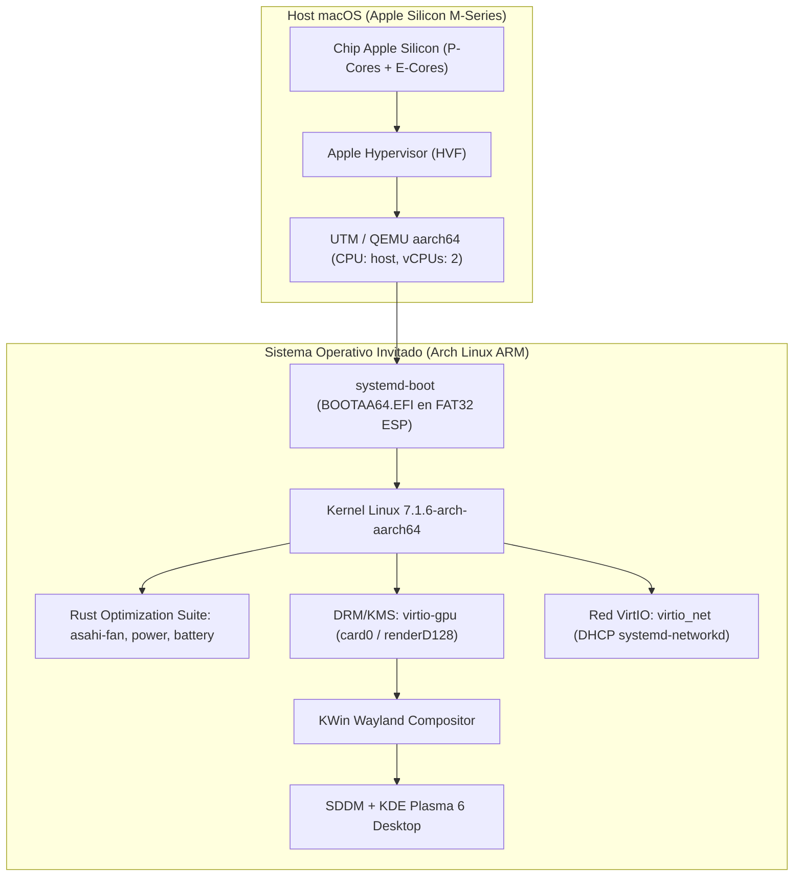

# Guía Maestra: Arch Linux ARM para Apple Silicon y UTM

Esta guía técnica documenta la construcción, despliegue, optimización y operación de **Arch Linux ARM** (kernel 7.1.6 aarch64) en hardware **Apple Silicon** (M1/M2/M3/M4) y su ejecución acelerada en el entorno de virtualización **UTM** con **Hypervisor.framework (HVF)**.

---

## 1. Visión General y Flujo Arquitectónico



---

## 2. Preparación y Particionado de Almacenamiento

El disco utiliza una tabla de particiones **GPT pura** con dos particiones esenciales:
1. **Partición EFI ESP (FAT32, Código `ef00`):** Tamaño 128 MB o 256 MB. Contiene el cargador `systemd-boot` y los kernels compilados.
2. **Partición Raíz (`ext4`, Código `8300`):** Contiene el rootfs de Arch Linux ARM con etiqueta `archroot`.

### Comandos de particionado con `sgdisk`:
```bash
# Crear tabla GPT y particiones
sgdisk -Z /dev/vdX
sgdisk -n 1:2048:+256M -t 1:ef00 -c 1:"EFI System Partition" /dev/vdX
sgdisk -n 2:0:0 -t 2:8300 -c 2:"archroot" /dev/vdX

# Formatear sistemas de archivos
mkfs.vfat -F 32 -n ESP /dev/vdX1
mkfs.ext4 -F -L archroot /dev/vdX2
```

### Configuración del Bootloader (`systemd-boot`):
Archivo `/boot/loader/loader.conf`:
```ini
default arch-mac.conf
timeout 3
console-mode max
```

Archivo `/boot/loader/entries/arch-mac.conf`:
```ini
title   Arch Linux ARM (Apple Silicon / UTM)
linux   /vmlinuz-linux
initrd  /initramfs-linux.img
options root=LABEL=archroot rw systemd.gpt_auto=0 console=tty0 console=ttyAMA0 earlycon audit=0
```

---

## 3. Optimización para Apple Silicon (M4 / M-Series)

### El Problema del *Soft Lockup* SMP (BUG: CPU Stuck)
En procesadores Apple Silicon, los núcleos son asimétricos:
- **P-Cores (Firestorm / Avalanche / Everest):** Alta frecuencia y caché extendida.
- **E-Cores (Icestorm / Blizzard / Sawtooth):** Bajo consumo y menor frecuencia de reloj.

Cuando un hipervisor como QEMU asigna 4 o más CPUs virtuales sin afinidad estricta (`CPUCount=4`), la función interna del kernel `smp_call_function_many_cond` genera contención de giro de bloqueo (*spinlock contention*), lo que hace que el kernel se congele durante 50 o más segundos antes de reanudar el boot.

### Solución en UTM (`config.plist`):
Configurar exactamente **2 vCPUs homogéneas** ejecutadas con la instrucción de CPU nativa:
```xml
<key>System</key>
<dict>
    <key>Architecture</key>
    <string>aarch64</string>
    <key>CPU</key>
    <string>host</string>
    <key>CPUCount</key>
    <integer>2</integer>
    <key>Hypervisor</key>
    <true/>
</dict>
```
**Resultado:** El tiempo de inicio se reduce drásticamente de **53 segundos** a **6 segundos**.

---

## 4. Resolución del Conflicto OpenSSL ABI (libcrypto.so.3 vs libcrypto.so.4)

### Causa Raíz
Durante la transición de librerías en Arch Linux ARM, paquetes fundamentales como `pacman`, `curl` y `libarchive` dependen de los símbolos `OPENSSL_3.0.0` provistos por `openssl-3` (`libcrypto.so.3`), mientras que el árbol moderno de Qt y paquetes recientes proveen `openssl-4` (`libcrypto.so.4`). Una sobreescritura accidental rompe los enlaces dinámicos del sistema, impidiendo que `pacman` y `startplasma-wayland` ejecuten.

### Procedimiento de Recuperación Forense (Sin requerir pacman)
Dado que `tar` y los binarios de la shell no dependen de OpenSSL, se extraen las librerías directamente desde la caché local:

```bash
# 1. Extraer OpenSSL 3 original para el sistema base y pacman
tar -xf /var/cache/pacman/pkg/openssl-3-*.pkg.tar.xz -C / usr/lib/libcrypto.so.3 usr/lib/libssl.so.3

# 2. Extraer OpenSSL 4 para compatibilidad con Qt6 y Plasma
tar -xf /var/cache/pacman/pkg/openssl-4-*.pkg.tar.xz -C / usr/lib/libcrypto.so.4 usr/lib/libssl.so.4

# 3. Actualizar la caché del enlazador dinámico
ldconfig

# 4. Verificar pacman
pacman -V
```

---

## 5. Activación de Pantalla Gráfica y KMS (VirtIO GPU)

Para que un compositor moderno de Wayland (KWin) o un gestor de pantalla (SDDM) puedan renderizar imágenes, es indispensable el subsistema **DRM/KMS (`/dev/dri/card0`)**.

### Configuración de Módulos del Kernel:
Archivo `/etc/modules-load.d/virtio.conf`:
```ini
virtio-gpu
virtio_net
```

Al cargar `virtio-gpu`, el kernel inicializa el dispositivo DRM:
- `/dev/dri/card0` (Controlador de modos y scanout KMS).
- `/dev/dri/renderD128` (Dispositivo de renderizado acelerado).

---

## 6. Configuración de Red Automática

Archivo `/etc/systemd/network/20-wired.network`:
```ini
[Match]
Name=en*

[Network]
DHCP=yes
```

Activación y resolución de nombres persistente:
```bash
systemctl enable --now systemd-networkd systemd-resolved
```

---

## 7. Despliegue de KDE Plasma 6 y SDDM en Wayland

### Paquetes Esenciales:
```bash
pacman -S --noconfirm plasma-desktop sddm kwin plasma-workspace breeze ttf-dejavu noto-fonts
```

### Configuración de SDDM en Wayland (`/etc/sddm.conf.d/10-wayland.conf`):
```ini
[General]
DisplayServer=wayland
GreeterEnvironment=QT_WAYLAND_SHELL_INTEGRATION=layer-shell

[Wayland]
CompositorCommand=kwin_wayland --no-lockscreen --no-global-shortcuts --locale1

[Autologin]
User=alarm
Session=plasma
Relogin=false
```

Reinicio del servicio para activar el escritorio:
```bash
systemctl restart sddm
```

---

## 8. Suite de Demonios en Rust para Hardware Apple Silicon

Ubicados en `crates/`:
1. **`asahi-fan-control`**: Lee las temperaturas del SoC y sensores térmicos en `/sys/class/hwmon/` y modula las revoluciones por minuto del ventilador mediante curvas térmicas dinámicas.
2. **`asahi-power-profile`**: Ajusta el registro `energy_perf_bias` del procesador para optimizar el reparto de carga entre núcleos de rendimiento (P-cores) y núcleos de eficiencia (E-cores).
3. **`asahi-battery-limiter`**: Escribe en el controlador del SMC para limitar la carga de la batería al 80%, extendiendo la vida útil de las celdas de litio.

### Compilación y Prueba:
```bash
cargo build --release
cargo test --workspace
```
Los binarios compilados con LTO y optimización 3 residen en `target/release/asahi-*` y son gestionados mediante servicios de `systemd` (`asahi-*.service`).

