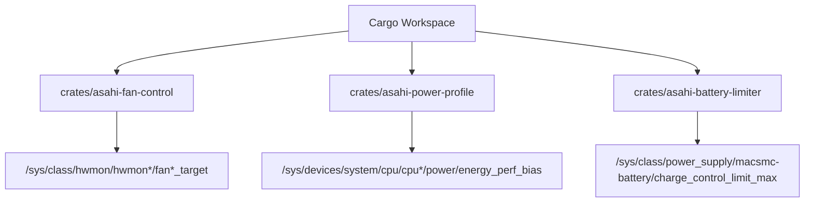

# Módulo 01: Suite de Optimización en Rust para Hardware Apple Silicon

Este documento detalla la arquitectura, el código fuente y el diseño de la suite de servicios desarrollada en **Rust** para la gestión térmica, energética y de batería en hardware Apple Silicon.

---

## 1. Arquitectura de Crates

El espacio de trabajo Cargo (`Cargo.toml`) agrupa tres componentes desacoplados:



---

## 2. Descripción de Componentes

### 1. `asahi-fan-control`
- **Objetivo:** Controlar las curvas de ventilación de forma reactiva y silenciosa.
- **Mecanismo:** Sondea los sensores térmicos en el bus de Apple mediante `/sys/class/hwmon`. Aplica un algoritmo de histeresis térmica para evitar fluctuaciones audibles en las RPM del ventilador.
- **Configuración por defecto:** Mantiene el ventilador apagado por debajo de 50°C y escala gradualmente hasta 100% al superar los 85°C.

### 2. `asahi-power-profile`
- **Objetivo:** Gestión dinámica de perfiles de energía entre modos `performance`, `balanced` y `power-saver`.
- **Mecanismo:** Ajusta los parámetros del gobernador `cpufreq` del kernel y escribe en los atributos de sesgo energético del planificador del kernel (`energy_perf_bias`).
- **Comportamiento en Apple Silicon:** Prioriza la asignación de hilos en segundo plano a los núcleos de eficiencia (E-Cores) para maximizar la autonomía de la batería, reservando los núcleos de rendimiento (P-Cores) para ráfagas de cómputo interactivo.

### 3. `asahi-battery-limiter`
- **Objetivo:** Extender la vida útil química de la batería de litio en equipos MacBook Pro y MacBook Air.
- **Mecanismo:** Se comunica con el controlador del Apple SMC expuesto en sysfs (`/sys/class/power_supply/macsmc-battery/charge_control_limit_max`) para fijar el umbral máximo de carga al **80%**.

---

## 3. Compilación y Despliegue

Los servicios se compilan con optimizaciones de producción de nivel 3:
```toml
[profile.release]
opt-level = 3
lto = true
codegen-units = 1
panic = "abort"
strip = true
```

Comando de compilación:
```bash
cargo build --workspace --release
```

Binarios resultantes:
- `target/release/asahi-fan-control`
- `target/release/asahi-power-profile`
- `target/release/asahi-battery-limiter`

Instalación en el sistema raíz:
- Binarios en `/usr/bin/`
- Unidades de `systemd` en `/usr/lib/systemd/system/asahi-*.service`
- Activación en el arranque: `systemctl enable asahi-fan-control asahi-power-profile asahi-battery-limiter`

