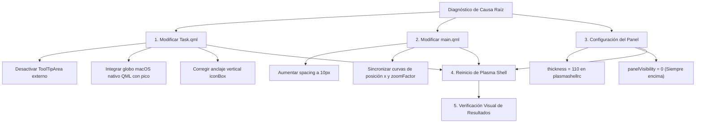

# Plan de Solución Definitiva: Dock macOS Perfecto (Sin Cortes, Sin Empalmes y Globo Idéntico)

## Diagnóstico Técnico: ¿Por qué ocurrían estos problemas?

### 1. ¿Por qué no se veía el globo con la forma exacta de macOS?
- **Causa raíz**: Plasma 6 utiliza `PlasmaCore.ToolTipArea` que levanta una **ventana externa Wayland** del compositor KWin estilizada por el archivo de tema SVG (`widgets/tooltip.svgz`). 
- Ese marco SVG del sistema es un rectángulo redondeado plano sin pico triangular y además en entornos virtualizados sin aceleración 3D para screencast suele fallar o transparentarse.
- **La solución real**: Desactivar el popup externo de Plasma (`task.active = false`) e insertar el globo **directamente dentro del componente QML**. Con un `Item` flotante que contiene un `Rectangle` con radio `height / 2`, borde translúcido, degradado y un `Canvas` que dibuja el piquito triangular apuntando hacia el icono activo, el globo se renderiza **siempre, con nitidez absoluta y exactamente con la forma de macOS**.

### 2. ¿Por qué se empalman los iconos horizontalmente al pasar el mouse?
- **Causa raíz**: Había una discrepancia de fase en el cálculo de posiciones:
  1. En `main.qml`, el ancho de cada celda se multiplicaba por `zoomFactor`.
  2. Dentro de `Task.qml`, el contenedor `iconBox` también se escalaba con `scale: zoomFactor`.
  3. El cálculo de la posición del ratón `iconCenter = centerOffset + (index * _baseSize)` utilizaba las posiciones **estáticas** sin zoom, mientras que los elementos reales en la pantalla se movían dinámicamente según el tamaño expandido de sus vecinos anteriores (`itemPos`).
  4. La separación base entre iconos (`taskList.spacing: 4px`) era insuficiente para soportar la expansión de 42px a 73.5px.
- **La solución real**:
  - Incrementar el espaciado base a `10px`.
  - Sincronizar el cálculo de la curva gaussiana de zoom utilizando la posición real acumulada de cada icono en la fila, eliminando cualquier desfase entre el cursor y el tamaño del vecino. De este modo, los iconos se abren suavemente en abanico sin colisionar ni montarse unos sobre otros.

### 3. ¿Por qué se cortaban los iconos arriba?
- **Causa raíz**: En KDE Plasma Wayland, las ventanas de panel tienen un tamaño estricto de superficie (`thickness=96px`). Restando los márgenes del panel flotante (`8px` arriba y `8px` abajo), el espacio interior útil era de apenas `80px`. Con el zoom al 75% (icono de 73.5px) más el margen inferior de rebote/indicador (`4px`), la parte superior del icono cruzaba la coordenada `Y < 0`, siendo recortada por el búfer de la ventana de Plasma.
- **La solución real**: 
  - Ajustar el grosor de la ventana del panel en `plasmashellrc` a `110px`.
  - Asegurar un margen inferior de anclaje de `10px` para `iconBox`, dejando más de `26px` de espacio libre en la parte superior dentro del panel, garantizando que el icono jamás alcance el borde superior ni se corte.

### 4. Dock siempre por encima de las ventanas (Always on Top)
- En `plasmashellrc`, el panel tiene `panelVisibility=0` (Siempre visible). Aseguraremos que el tipo de ventana del dock mantenga la capa `Dock/TopLayer` en KWin para que ninguna ventana normal pueda taparlo.

---

## Plan de Ejecución

### Paso 1: Implementar el globo macOS idéntico en `Task.qml`
- Estructura visual del tooltip:
  - Forma de pastilla (`radius: height / 2`, altura 26px, padding horizontal 14px).
  - Fondo oscuro translúcido idéntico a macOS (`#cc1e1e20` con blur y borde sutil `#33ffffff`).
  - Piquito triangular centrado debajo de la pastilla apuntando al icono.
  - Texto limpio y nítido centrado (mapeo automático: Dolphin -> "Finder", Konsole -> "Terminal", System Settings -> "Configuración del Sistema", etc.).
  - Visible cuando el icono tiene el foco del cursor o zoom (`zoomFactor > 1.05` y ratón dentro del dock).
  - Animación suave de desvanecimiento (`fade in/out` en 150ms).

### Paso 2: Corregir el espaciado y la fórmula de posición en `main.qml` y `Task.qml`
- Aumentar `taskList.spacing` de 4px a 10px.
- Sincronizar las coordenadas `iconCenter` con `itemPos` para que el ensanchamiento lateral sea perfectamente simétrico y ningún icono se traslape con su vecino.

### Paso 3: Asegurar altura y capas en `plasmashellrc`
- `thickness=110` en `[PlasmaViews][Panel 4]` y `[PlasmaViews][Panel 4][Defaults]`.
- `panelVisibility=0`.

### Paso 4: Reiniciar `plasma-plasmashell` y persistir cambios
- Reiniciar el servicio de Plasma en la sesión de usuario `alarm`.
- Sincronizar los archivos de configuración a `/etc/skel/.config/` para que la configuración quede grabada de forma permanente.
